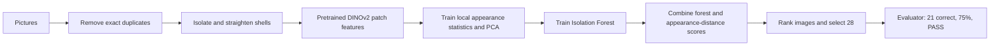
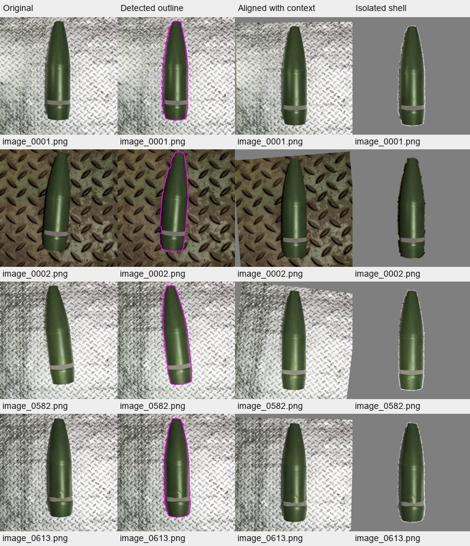
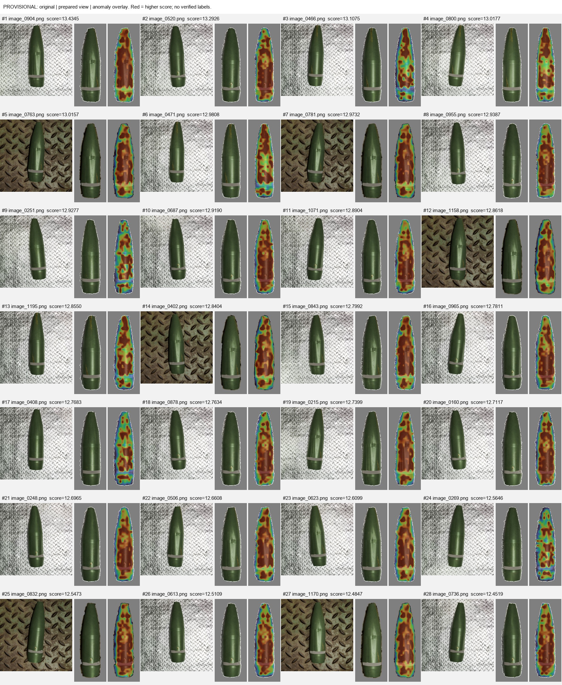

- 1,225 unique images, named `image_0001.png` through `image_1225.png`.
- 16 exact duplicate copies, named `image_0001(1).png` through `image_0016(1).png`.

1. Find reliable green pixels as foreground seeds.
2. Use **GrabCut** to estimate the shell silhouette, retaining non-green details such as the pale band and surface marks.
3. Estimate the long-axis angle, straighten the shell, and center it.
4. Create masks, an aligned context view, an isolated foreground view, and a crop.
5. Retain the original image for checking anything that looks suspicious in a processed view.

I used **DINOv2 ViT-S/14**, a pretrained small vision transformer, as a frozen feature extractor. It describes visual appearance without needing labels for these particular shells.

Each prepared crop was resized proportionally and padded onto a **196 × 504** canvas. DINOv2 divided that canvas into **14 × 14 pixel patches**, producing a **14 × 36 grid: 504 patch positions**. Each patch received a 384-number feature vector, normalized to unit length.

A feature vector is a compact description, not a defect label. It can carry information about texture, shape, and appearance that is more useful than a direct raw-pixel comparison.

### Learn typical appearance at each position

At each supported grid position, we learned the median feature values and their variation across fitting images. We used median absolute deviation, or **MAD**, as a robust measure of spread.

We expressed a patch as its deviation from that position's typical appearance. Thus, a region around the pale band was judged relative to the usual appearance there, rather than directly against a shell nose.

### Fit PCA and Isolation Forest

We fitted **PCA with 32 components** to simplify the patch deviations. The forest received the PCA coordinates, residual magnitude, patch location, and foreground coverage.

Then we trained an **Isolation Forest with 256 trees per fold**, sampling up to 512 points for each tree. It repeatedly makes random feature splits. Unusual combinations can become isolated after fewer splits, giving them higher anomaly scores.

The model was trained on up to **60,000 sampled patches per fold**. It used no normal/defect labels. We used its scores for ranking; we did not ask its built-in threshold to identify exactly 28 defects.

