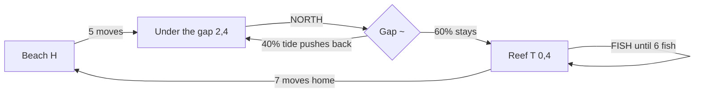

The canoe has **24 steps** per day. It starts on the beach `H` with an empty hold and scores only the fish it brings back to the beach.

```
    0 1 2 3 4 5 6
 0  . . . . T T .     T  outer reef: 90% bite chance, far away
 1  # # # # ~ # #     #  wall, ~ the only gap (passage)
 2  . . . . s s .     s  seagrass: 20% bite chance, close
 3  . . . . s s .
 4  . . . . . . .
 5  . . H . . . .     H  beach: start and landing point
```

| Rule                   | Value                                                                          |
| :--------------------- | :----------------------------------------------------------------------------- |
| Bite chance per `FISH` | seagrass `s` **20%**, outer reef `T` **90%**                                   |
| Hold capacity          | **6** fish                                                                     |
| Tide                   | ending a step on `~` (1,4) pushes the canoe one cell south **40%** of the time |
| End of day             | fish still in the hold are **lost**                                            |


| Plan                  | Travel               | Fishing               | Fish landed             |
| :-------------------- | :------------------- | :-------------------- | :---------------------- |
| Seagrass (angkol)     | 4 out + 4 back       | about 16 steps at 20% | about 2.5               |
| **Outer reef (ours)** | about 7 out + 7 back | about 7 steps at 90%  | **about 6 (hold full)** |



1. **Go home** if the hold is full, or if the steps left are no more than the trip home.
2. **Fish** if the canoe is on `T`.
3. **Head for the reef** at (0,4) if there is time to get there, fish once and return.
4. **Fallback:** fish the seagrass if there is still time for it, otherwise go home.