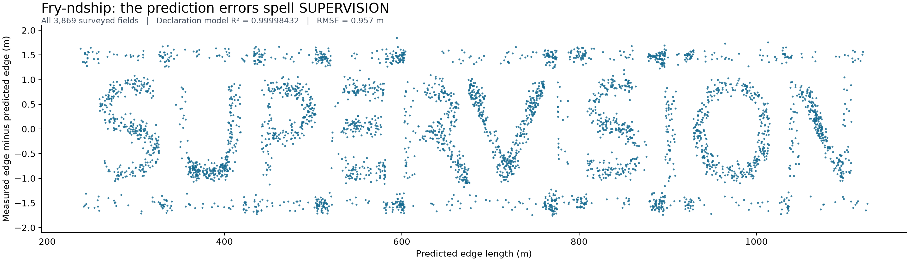

---
tags:
  - machine-learning
  - regression
  - ctf
country: Belgium
status: solved
flag: SIGMOID_SUPERVISIO
---

# Fry-ndship

| Column | Meaning |
| --- | --- |
| `area_ha` | How much ground is inside the field, in hectares |
| `long_side_m` | The longest side, in metres |
| `ditch_m` | The length of the ditch alongside the field, in metres |
| `edge_m` | The actual perimeter Mariette measured, in metres |

```text
area = length × width
width = area ÷ length
```

```text
short_side_m = area_ha × 10000 ÷ long_side_m
```

```text
area = 1.0225 × 10000 = 10225 m²
long side = 177.5 m
short side ≈ 10225 ÷ 177.5 ≈ 57.61 m
```

```text
estimated perimeter = a × long side + b × short side + c × ditch + d
```

| Possible rule | Estimate | Comparison with 448.79 m |
| --- | ---: | --- |
| `0.8 × long side + 0.8 × short side + ditch` | 425.79 m | About 23 m too low |
| `0.9 × long side + 0.9 × short side + ditch` | 449.30 m | About 0.51 m too high |
| `1.0 × long side + 1.0 × short side + ditch` | 472.81 m | About 24 m too high |

| Part of the rule | Learned value |
| --- | ---: |
| Long-side multiplier | 0.90001948 |
| Short-side multiplier | 0.90002305 |
| Ditch multiplier | 0.99997969 |
| Added constant | -0.00109811 |


```text
estimated perimeter ≈ 0.9 × long side + 0.9 × short side + ditch
```

```text
estimated perimeter ≈ 0.9 × 177.5 + 0.9 × 57.61 + 237.7 ≈ 449.30 m
```

```text
residual = measured perimeter − estimated perimeter
```

```text
residual ≈ 448.79 − 449.30 ≈ −0.51 m
```

| Residual | Meaning |
| --- | --- |
| Negative | Our estimate was too high |
| Positive | Our estimate was too low |
| Zero | Our estimate matched the measurement |




