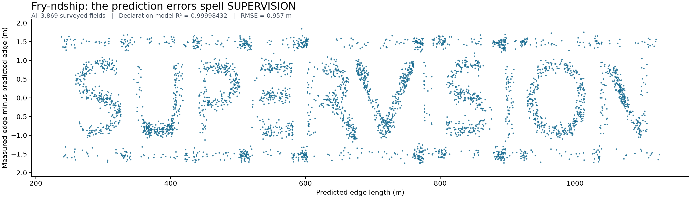

# Fry-ndship solution

1. Load the 3,869 surveyed fields from `potato_fields.csv`.
2. Convert hectares to square metres and estimate the short side using a rectangular approximation: `short_side_m = 10000 * area_ha / long_side_m`.
3. Fit linear regression with an intercept using `long_side_m`, `short_side_m`, and `ditch_m`, all available from declarations. The fitted model is approximately `predicted_edge_m = 0.9 * (long_side_m + short_side_m) + ditch_m`, with R² = 0.99998432.
4. Calculate the prediction errors: `residual_m = edge_m - predicted_edge_m`.
5. Plot predicted edge length on the horizontal axis and residuals on the vertical axis. The points spell **SUPERVISION**.

Omitting `ditch_m` reveals **REGRESSION**. Adding `hedge_m` reveals **PREDICTION**, but the hedge was measured on site and is unavailable for predicting unsurveyed fields. The declaration-only model reveals **SUPERVISION**; `model_comparison.png` shows all three results.

**Confirmed flag: `SIGMOID_SUPERVISION`** (accepted by the platform, as reported by the user).
