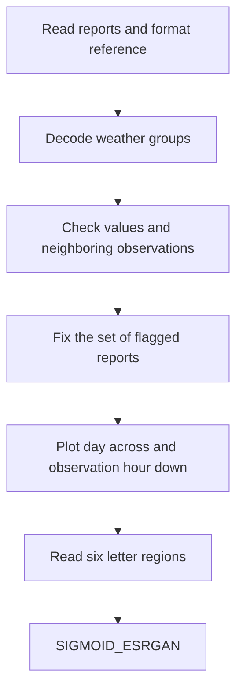
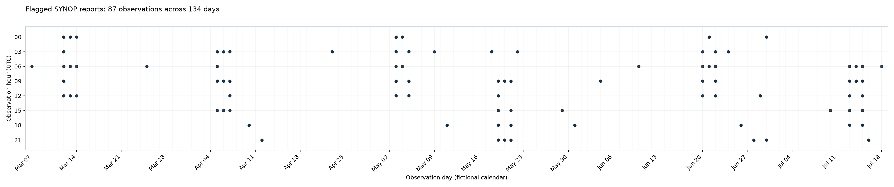
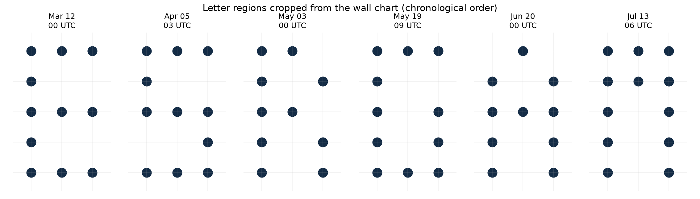

The input contains **134 days × 8 observations per day = 1,072 reports**. Once we identify a corrupted report, its date and observation hour tell us exactly where to place its point on the chart.



```text
0001 1987-03-07 00Z AAXX 07001 89624 41684 21102 11108 21167 39743 49798 58002 70211 81530 333 11098 21118=
```

| Part | How to read it | Meaning |
| --- | --- | --- |
| `0001` | Sequence number | Report 1 |
| `1987-03-07` | Date outside the SYNOP message | March 7, 1987 |
| `00Z` | Observation hour; `Z` means UTC | Midnight UTC |
| `AAXX` | Report identifier | Land-station weather report |
| `07001` | `07 · 00 · 1` | Day 07, hour 00, wind measured in m/s |
| `89624` | Station identifier | The fictional station index used in this task |
| `41684` | `4 · 1 · 6 · 84` | No precipitation-amount group; present-weather group included; lowest cloud base 1,000–1,500 m; visibility 50 km |
| `21102` | `2 · 11 · 02` | Total cloud cover 2/8 of the sky; wind direction 110°; wind speed 2 m/s |
| `11108` | `1 · 1 · 108` | Air temperature: −10.8 °C |
| `21167` | `2 · 1 · 167` | Dew-point temperature: −16.7 °C |
| `39743` | `3 · 9743` | Station pressure: 974.3 hPa |
| `49798` | `4 · 9798` | Pressure adjusted to sea level: 979.8 hPa |
| `58002` | `5 · 8 · 002` | Pressure fell by 0.2 hPa over the preceding three hours |
| `70211` | `7 · 02 · 1 · 1` | Present-weather code 02; past-weather codes 1 and 1 |
| `81530` | `8 · 1 · 5 · 3 · 0` | Low/middle cloud amount 1/8; low-cloud type 5, middle-cloud type 3, high-cloud type 0 |
| `333` | Section marker | Supplementary data begins here |
| `11098` | `1 · 1 · 098`, after `333` | Maximum over the preceding 12 hours: −9.8 °C |
| `21118` | `2 · 1 · 118`, after `333` | Minimum over the preceding 12 hours: −11.8 °C |
| `=` | End marker | The report is complete |


| Check | Reason for flagging |
| --- | --- |
| Invalid time group or illegal characters | The encoded observation time must match its timestamp and use the supplied format |
| Wind direction above code 36 | Outside the station's permitted direction range |
| Dew point above air temperature | Inconsistent temperature pair |
| Maximum below minimum | Contradictory 12-hour extremes |
| Low/middle cloud amount above total cover | Contradictory cloud amounts; obscured sky is handled separately |
| Gust below sustained wind | Inconsistent wind measurements |
| Wind speed above 60 m/s | An isolated extreme relative to this file's surrounding reports |
| Temperature more than 10 °C from both immediate neighbors | An isolated excursion in an otherwise continuous sequence |
| Sea-level minus station pressure outside 5.0–6.2 hPa | Anomalous pressure correction relative to this station's observed band |

We also compare the observed three-hour station-pressure change with the reported tendency. Approximately opposite residuals in consecutive intervals identify a changed pressure at their shared observation, so the following clean report is not automatically flagged. Residuals must exceed **0.3 hPa**, with **0.2 hPa** tolerance when checking cancellation.

Contextual checks cover dew-point depression below **0.4 °C**, precipitation codes with zero cloud cover, and snow codes **70–79** with visibility codes above **80**. A wind-direction departure of at least **100°** from the local median also needs an isolated jump from both immediate neighbors with wind at least **7 m/s**, or support from at least three neighboring anomalous observations. These empirical checks produce **87 flagged reports**. Letter templates are applied only after the selection is fixed; removing the font table does not change those 87 reports.


| Report | Decoded problem |
| --- | --- |
| **0003** | Air temperature is −10.0 °C, but dew point is −8.8 °C |
| **0042** | Air temperature jumps to −2.9 °C between −16.9 °C and −13.1 °C |
| **0057** | The maximum is −9.5 °C, below the minimum of −7.3 °C |
| **0147** | Wind speed is 75 m/s, between neighboring speeds of 6 and 8 m/s |
| **0687** | Sustained wind is 13 m/s, but the reported since-previous-observation gust is only 11 m/s |
| **0895** | Time group `26V81` contains an illegal `V` |


$$
x = \text{date} - \text{1987-03-07}, \qquad y = \frac{\text{hour UTC}}{3}.
$$







| Starting day offset | Starting date | Top observation hour | Reading |
| ---: | --- | --- | --- |
| 5 | March 12 | 00 UTC | E |
| 29 | April 5 | 03 UTC | S |
| 57 | May 3 | 00 UTC | R |
| 73 | May 19 | 09 UTC | G |
| 105 | June 20 | 00 UTC | A |
| 128 | July 13 | 06 UTC | n → N |

Reading left to right and converting to uppercase gives **ESRGAN**. The accepted flag is **`SIGMOID_ESRGAN`**.

Run these commands from this task folder:

```powershell
python -m pip install -r requirements.txt
python solve.py
```

The script prints the flag and regenerates `corrupted.csv`, `chart.png`, and `letters.png`.
