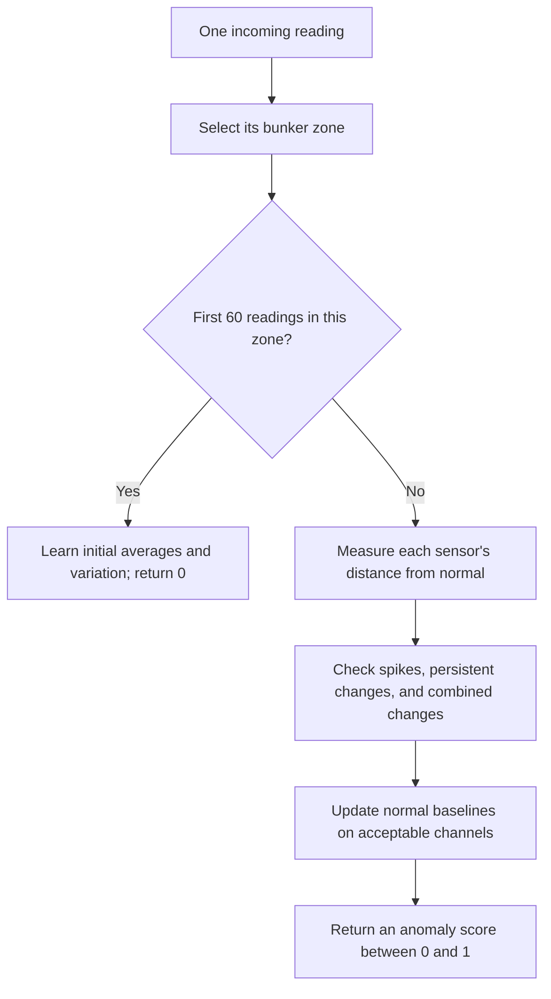

| File | Contents | Purpose |
| --- | --- | --- |
| [[task_albania/train-input.csv]] | 3,600 rows of sensor measurements | Readings supplied to the detector |
| [[task_albania/train-output.csv]] | 3,600 matching labels | Correct answers used during development |

| Field | Value | Meaning |
| --- | --- | --- |
| `timestamp` | `2026-05-01 00:00:00` | Measurement time |
| `bunker_zone` | `north_gallery` | Measurement location |
| `temperature_c` | 12.8414 | Temperature in Celsius |
| `humidity_pct` | 71.7461 | Relative humidity |
| `vibration_g` | 0.122914 | Vibration |
| `acoustic_db` | 31.9758 | Sound level |
| `air_pressure_kpa` | 101.4557 | Air pressure |
| `co2_ppm` | 525.8187 | Carbon dioxide concentration |

The corresponding output row has `is_anomaly = 0` and `anomaly_type = normal`. The input and output timestamps match, so we know which answer belongs to which reading.

| Label | Number of readings | What it means |
| --- | ---: | --- |
| Normal | 3,313 | Ordinary conditions |
| Point | 7 | Isolated abnormal readings |
| Drift | 180 | Readings within three gradual-change intervals |
| Collective | 100 | Readings within three intervals of combined changes |

| Sensor | Initial average | Initial standard deviation |
| --- | ---: | ---: |
| Temperature | 13.15957 | 0.22242 |
| Humidity | 71.86789 | 0.59347 |
| Vibration | 0.121252 | 0.010803 |
| Sound | 32.12913 | 0.31589 |
| Air pressure | 101.51998 | 0.048742 |
| CO₂ | 511.59281 | 13.27875 |

$$
z_i = \frac{x_i - \mu_i}{\sigma_i}
$$

| Symbol | Meaning |
| --- | --- |
| $i$ | Which of the six sensors we are considering |
| $x_i$ | That sensor's value in the incoming reading |
| $\mu_i$ | Its learned average before processing this reading |
| $\sigma_i$ | Its learned standard deviation before processing this reading |
| $z_i$ | How far the value is from its average, measured in standard deviations |
| $|z_i|$ | The magnitude of that distance, ignoring whether it is above or below average |

$$
S_{point} = \frac{\max_i |z_i|}{4.5}
$$

$$
m_{i,t} = 0.8m_{i,t-1} + 0.2\widetilde{z}_{i,t}
$$

$$
S_{collective} = \begin{cases}
\dfrac{\sqrt{e_{(1)}^2 + e_{(2)}^2 + e_{(3)}^2}}{3.0}
\end{cases}
$$

$$
S = \max(S_{point},S_{drift},S_{collective})
$$

$$
score = \frac{S}{1 + S}
$$

| Setting                | Value | Role                                           |     |
| ---------------------- | ----: | ---------------------------------------------- | --- |
| `alpha`                |  0.01 | How quickly the learned average adapts         |     |
| `threshold`            |   4.5 | Instantaneous spike threshold                  |     |
| `smooth_alpha`         |   0.2 | New reading's contribution to deviation memory |     |
| `smooth_threshold`     |   2.5 | Persistent deviation threshold                 |     |
| `current_gate`         |   2.0 | Current deviation required to support a drift  |     |
| `collective_threshold` |   3.0 | Scale for combined persistent evidence         |     |

| Measure | Final result |
| --- | ---: |
| Competition score | 96.8659 / 100 |
| F1 | 96.13% |
| Precision | 92.86% |
| Overall recall | 99.65% |
| Point recall | 100%: 7 of 7 |
| Drift recall | 99.44%: 179 of 180 |
| Collective recall | 100%: 100 of 100 |
| True positives | 286 |
| False positives | 22 |
| False negatives | 1 |
| First-half score | 99.45 / 100 |
| Second-half score | 95.69 / 100 |
