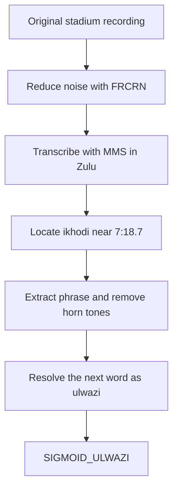

The input was `voice_note.wav`: **630 seconds**, **16 kHz**, **mono**, **16-bit PCM**.
Input details: [[Ngiyakuzwa (South Africa)/results/input_metadata.json|input metadata]].


The first useful cleanup used **FRCRN_SE_16K**, a pretrained speech-enhancement model available through ClearVoice. Its job was to suppress background noise while retaining the woman's voice.

The full recording was processed in **30-second blocks**. Each block included up to **one additional second on either side**. 

The cleaned blocks were joined at their original sample positions.


The cleaned recording was transcribed with **`facebook/mms-1b-all`**, explicitly selecting its **`zul` language adapter**. This makes the recognizer use its Zulu-specific components and vocabulary.

Recognition used **25-second windows with five seconds of overlap**, producing 32 transcript windows. 

The script saved the text and approximate word timestamps. It searched for both **ikhodi** and similar spellings.

The strongest candidate appeared in the window covering **420–445 seconds**. The raw recognition included:

```text
uzosebenzise ikhudi udwazo
```

This was a location clue, rather than a finished transcription: **ikhudi** resembled the expected keyword, and the immediately following word needed closer examination.

| Item | Approximate original time |
|---|---|
| Keyword, ikhodi | 7:18.7–7:19.2 |
| Following word | 7:19.9–7:20.4 |


A **16-second excerpt**, covering original seconds **431–447**, was extracted
The spectrogram showed strong, narrow horn tones over the voice. A classical filter targeted those tones before another FRCRN pass:

1. Estimate the audio's power spectrum.
2. Detect strong, narrow frequency peaks.
3. Apply narrow notch filters to suppress them.
4. Apply FRCRN again to reduce the remaining background noise.

![[Ngiyakuzwa (South Africa)/results/power_spectrum.png]]


Recognition varied with the processing and crop length. Outputs included forms such as **ulwazu**, **ulwazo**, and **ugwazi**. Comparing the processed phrase and these variations supported the standard spelling **ulwazi**.


![[Ngiyakuzwa (South Africa)/samples/key_phrase_frcrn.wav]]