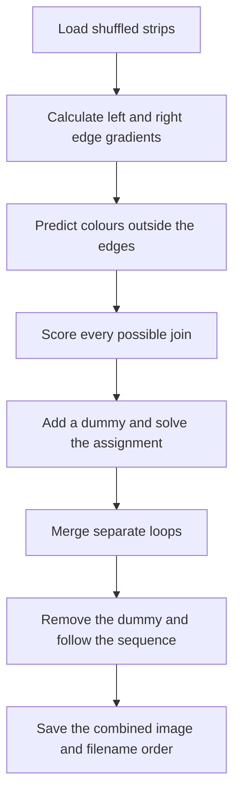

The dataset contained **192 shuffled PNG strips**, each **8 pixels wide and 1,024 pixels high**. The original painting was therefore **1,536 × 1,024 pixels**.


$$
L_i(y,c) = I_i(y,0,c), \qquad R_i(y,c) = I_i(y,w-1,c)
$$

$$
g_i^L(y,c) = I_i(y,1,c) - I_i(y,0,c)
$$

$$
g_i^R(y,c) = I_i(y,w-1,c) - I_i(y,w-2,c)
$$

$$
\widehat{R}_i(y,c) = R_i(y,c) + 0.5g_i^R(y,c)
$$

$$
\widehat{L}_i(y,c) = L_i(y,c) - 0.5g_i^L(y,c)
$$


$$
\boxed{C_{ij} = \sum_{y=0}^{H-1}\sum_{c=1}^{3}\left[(\widehat{R}_i(y,c) - L_j(y,c))^2 + (R_i(y,c) - \widehat{L}_j(y,c))^2\right]}
$$
### How does it find those changes?

The solver builds an assignment incrementally and can change earlier assignments when adding another one. The example illustrates the idea:

1. Suppose A is already assigned to B, at cost $1$.
2. D needs a successor. Assigning D to the free C would add $100$.
3. Alternatively, remove A → B, assign A → C, and assign D → B.
4. That rearrangement adds only $-1 + 2 + 2 = 3$ to the current cost.
5. The solver chooses the cheaper way to extend the assignment.

```text
D needs B → B is occupied by A → move A to C → B becomes available for D
```

$$
\boxed{\Delta = C_{xv} + C_{uy} - C_{xy} - C_{uv}}
$$

The new connection costs are added; the old connection costs are subtracted. When X is involved, its connection costs are zero. The code chooses the available exchange with the smallest cost increase and repeats until one loop remains.

We then remove X and follow the remaining connections:

```text
A → B → C → D
```

This is the recovered left-to-right strip order. The assignment step is optimal for its assignment objective, but merging loops is a heuristic. The complete method does not guarantee the globally best path for every possible image; it recovered the exact order in our tests and hidden evaluation.

## 8. Rebuild and save the image

We concatenate the original strips horizontally in the recovered order. Their pixels are preserved exactly. The script saves:

- `reconstructed_image.png`: the combined picture.
- `reconstructed_order.json`: the original filenames in left-to-right order.

Sorting filenames only makes loading deterministic; their numeric labels do not determine the reconstruction. `main.py` does not read the supplied reference order or training answers. Those are used only by `validate.py` for checking results.




![[The 300-Year Old Tiger Nest Painting (Bhutan)/reconstructed_image.png|1000]]
