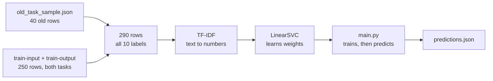

| Checkpoint | Trained on | Old accuracy | New accuracy |
| :-- | :-- | --: | --: |
| Original | old task only | 1.00 | 0.00 |
| Fine-tuned | new task only | 0.00 | 1.00 |
| **Ours (recovered)** | **both tasks together** | **≥ 0.85 needed** | **≥ 0.85 needed** |

| Request | Label |
| :-- | :-- |
| register a new order placed by Konan | `OLD_CRUD_INSERT_ORDER` |
| cancel and remove Fatou's account record | `OLD_CRUD_DELETE_ACCOUNT` |
| find every depot within a 20 kilometer radius of Vridi | `NEW_SPATIAL_WITHIN_RADIUS` |
| rank-order the fleet partition that truck-47 belongs to | `NEW_WINDOW_PARTITION_RANK_FLEET` |

| Source | Rows | Old labels | New labels |
| :-- | --: | --: | --: |
| `old_task_sample.json` | 40 | 40 | 0 |
| `train-input` / `train-output` | 250 | 125 | 125 |
| **Total** | **290** | **165** | **125** |

| Library      | Version | What it does here                                                            |
| :----------- | :------ | :--------------------------------------------------------------------------- |
| scikit-learn | 1.8.0   | The ML toolbox: `TfidfVectorizer`, `LinearSVC`, `Pipeline`, cross-validation |
| numpy        | 2.5.1   | Holds the numbers (arrays) that scikit-learn computes with                   |
| joblib       | 1.5.3   | Saves and loads the trained model (`.joblib` files)                          |

|                                                        | delete | account | radius | depot |  km |
| :----------------------------------------------------- | -----: | ------: | -----: | ----: | --: |
| delete the account belonging to Yao                    |    0.6 |     0.5 |      0 |     0 |   0 |
| find every depot within a 20 kilometer radius of Vridi |      0 |       0 |    0.6 |   0.5 |   0 |

| Test                                       |       Old |       New |
| :----------------------------------------- | --------: | --------: |
| Unseen sentences (5-fold CV)               | **0.986** | **1.000** |
| Stricter: whole sentence patterns held out |     ~0.93 |     ~0.97 |
| Gate                                       |      0.85 |      0.85 |

