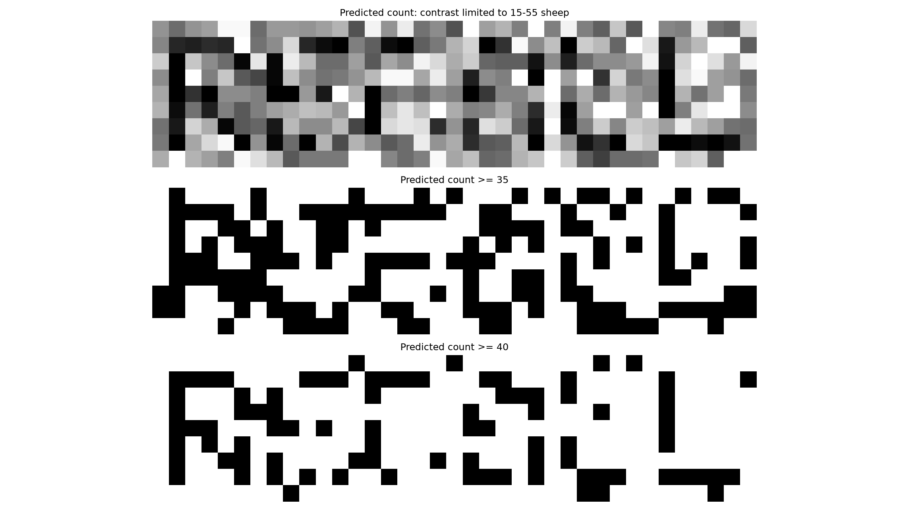

# The Baa-rilliant task! (Mongolia)

Recovered flag: **`SIGMOID_RECALL`**.

We used the pretrained **ICAERUS YOLOv8m sheep model v4** to estimate sheep counts, placed the counts at the survey coordinates, rotated the resulting grid, and read **RECALL** from its six letter blocks. We did not train or fine-tune the model. The word was read manually; platform acceptance has not been checked here.

Read [Solution (Obsidian).md](<Solution (Obsidian).md>) for the detailed walkthrough and embedded evidence. The original statement is preserved in [Task.md](Task.md).

## Main files

| File | Purpose |
|---|---|
| `counts.csv` | Submission counts: `image,count`, 333 unique survey photos |
| `flag.txt` | `SIGMOID_RECALL` |
| `solve.py` | Download/check the model, run counting and grid reconstruction, validate outputs |
| `common.py` | Shared file helpers, plotting setup, and model runtime configuration |
| `evaluate_model.py` | Compare predictions with labelled photos and select the confidence threshold |
| `predict_survey.py` | Count sheep in survey images and plot their coordinates |
| `decode_map.py` | Recover the rotated 9 × 37 grid and render count thresholds |
| `requirements.txt` | Pinned Python environment used for the solution |
| `evaluation/imgsz_640/` | Labelled-data metrics, comparisons, detection outputs, and review images |
| `survey_results/` | Survey detection outputs, grid tables, maps, and solution metadata |
| `models/icaerus_yolov8m_v4/` | Model source, upstream README, GPL-3.0 license, and local weights |

## How the word appears

1. Count sheep detections with confidence at least **0.425** in each survey photo.
2. Join `counts.csv` to `survey_plots.csv` using the image filename.
3. Centre the coordinates and project them onto their principal axes, removing a **26.97°** tilt.
4. Group the approximately **50-metre** spaced positions into **9 rows and 37 columns**, one image per cell.
5. Display the count matrix as shades of gray or apply count thresholds around **35–40**. Read the six noisy letter blocks manually as **RECALL**, resolving the third letter as **C**.



The count values are preserved as model estimates. The recovered word is recorded separately in `flag.txt` and `survey_results/solution_summary.json`.

## Reproduce on Windows

Run these commands from this task folder with Python 3.12. Keep the extracted input under `task_mongolia/`, containing `train/`, `survey/`, and the three original CSV files. The task statement links to the supplied data.

```powershell
python -m venv .venv
.\.venv\Scripts\python.exe -m pip install -r requirements.txt
.\.venv\Scripts\python.exe solve.py --evaluate --word RECALL
```

Existing detections are reused to reproduce the CSV files and figures quickly. To rerun the actual model on every image:

```powershell
.\.venv\Scripts\python.exe solve.py --evaluate --fresh --word RECALL
```

The `--word` argument records the human reading of the map; it is not an OCR prediction. Omit it to generate the counts and map without recording a word. The model is downloaded automatically if absent, and its SHA-256 is checked against the exact model used here. CPU execution is supported; a GPU is optional.

## Results and limits

The confidence threshold was selected on 210 labelled photos and evaluated separately on 70 photos. At confidence **0.425**, the mean absolute error on those 70 photos was **5.46 sheep per image**, with **14 exact counts**. Some supplied zero-count labels visibly contain sheep, which affects these metrics. Overlap between these photos and the external model's original training data has not been audited.

`counts.csv` contains the original automatic estimates, including imperfect counts. The map was decoded visually, with the ambiguous third letter read as **C**. This is evidence of the recovered word, not a claim that all 333 counts are exact or that the platform has accepted the submission.

Input photos, ZIP archives, model weights, caches, and the local Python environment are excluded from Git. Obsolete exploratory scripts and figures are kept in the local `_archive/`, also excluded from Git. The retained source metadata and downloader allow the model to be restored. The repository does not claim ownership of the upstream model; its [source and license](https://github.com/ICAERUS-EU/UC3_Livestock_Monitoring) are retained under `models/`.

The competition submission needs the flag and a public URL containing the code, counts, and write-up.
