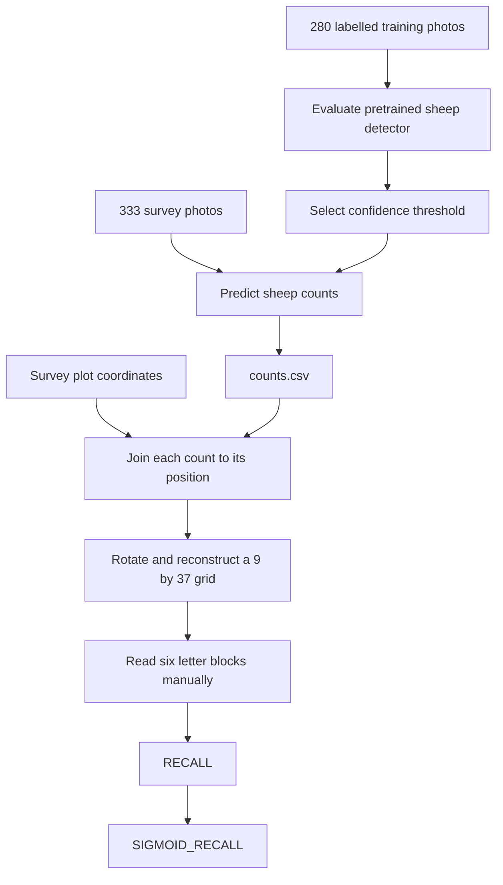

| Input | Contents | Role |
|---|---|---|
| `train/` | 280 photos, each 600 × 600 pixels | Labelled examples for evaluation |
| `train_counts.csv` | `image,count` | Supplied total for each training photo |
| `train_points.csv` | `image,x,y` | Body-centre annotations, one dot per labelled sheep |
| `survey/` | 333 photos, each 600 × 600 pixels | Photos whose counts were needed |
| `survey_plots.csv` | `image,x_m,y_m` | The geographic position of each survey photo |


We downloaded **ICAERUS YOLOv8m sheep detection model v4**, which was already trained to detect sheep. The task statement did not require us to train a new model.

- [Upstream project](https://github.com/ICAERUS-EU/UC3_Livestock_Monitoring)
- [Specific model and upstream documentation](https://github.com/ICAERUS-EU/UC3_Livestock_Monitoring/tree/main/models/sheep_detection/yolo8m_sheep_v4)
- Local model file: `models/icaerus_yolov8m_v4/yolov8m_all_finetune.pt`
- Model size: **52,033,938 bytes**
- Upstream license: **GPL-3.0**, retained beside the model metadata


## 3. Check accuracy and choose a confidence threshold

We evaluated the detector using [[The Baa-rilliant task! (Mongolia)/evaluate_model.py|evaluate_model.py]]. This was **inference and threshold calibration**, not training: the network weights were unchanged.

We shuffled the 280 labelled photos using seed **2026**, then used:

- **210 photos** to select the confidence threshold.
- **70 separate photos** to evaluate the selected threshold.

| Metric on the same 70 evaluation photos | Default confidence 0.25 | Selected confidence 0.425 |
|---|---:|---:|
| Mean absolute error, sheep per image | 7.44 | 5.46 |
| Exact counts | 12 / 70 | 14 / 70 |
| Counts within ±2 sheep | 35 / 70 | 43 / 70 |
| Counts within ±5 sheep | 46 / 70 | 51 / 70 |


![[The Baa-rilliant task! (Mongolia)/evaluation/imgsz_640/count_accuracy.png]]

Plotting the original coordinates showed a long rectangular arrangement tilted northeast. Its main direction was approximately **26.97°** from the x-axis.

![[The Baa-rilliant task! (Mongolia)/survey_results/survey_map.png]]


![[The Baa-rilliant task! (Mongolia)/survey_results/decoded_grid.png]]

![[The Baa-rilliant task! (Mongolia)/survey_results/decoding_sensitivity.png]]


```text
SIGMOID_RECALL
```
