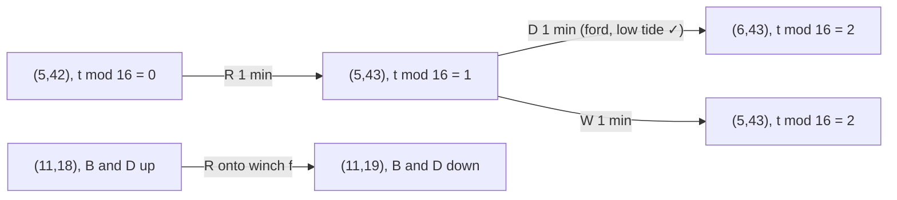

---
tags:
  - search
  - shortest-path
  - dijkstra
  - ctf
country: New Zealand
status: solved
difficulty: hard
result: 293 minutes
flag: SIGMOID_BELLMAN
---

You walk on a grid of 47 × 61 cells from the hut `S` (top left) to the hut `G` (bottom right). Each action is one of:

| Action          | Meaning                                |
| --------------- | -------------------------------------- |
| `U` `D` `L` `R` | move one cell up / down / left / right |
| `W`             | wait one minute where you stand        |

Your **score is the minute you arrive at `G`**. You need **296 or less**.

### Map symbols

| Symbol | Cell | Can you stand on it? |
| --- | --- | --- |
| `.` | ground | always |
| `,` | swamp | always, but slow to enter |
| `#` | rock | never |
| `=` | deep water | never |
| `~` | ford | only at low tide |
| `A`–`I` | swing bridge | only while that bridge is **down** |
| `a`–`l` | winch | always; stepping onto it flips bridges |
| `S` / `G` | start / goal hut | always |

| Action                                   | Minutes                          |
| ---------------------------------------- | -------------------------------- |
| step onto ground / ford / bridge / winch | 1                                |
| step onto swamp `,`                      | 3                                |
| climbing                                 | +1 for every height level gained |
| going downhill or level                  | +0                               |
| wait `W`                                 | 1                                |

| `minute mod 16` | Tide | Ending on a ford `~` |
| --- | --- | --- |
| 0, 1, 2, 3, 4 | low | ✅ allowed |
| 5 … 15 | high | ❌ route invalid |

| Winch | Flips | Winch | Flips |
| --- | --- | --- | --- |
| `a` | D | `g` | C, E |
| `b` | F | `h` | H |
| `c` | A, D | `i` | A |
| `d` | H, I | `j` | B |
| `e` | E | `k` | A |
| `f` | B, D | `l` | F |

| Channel | Rows | Ways across |
| --- | --- | --- |
| 1 | 6–8 | bridge `A`, fords at columns 43 and 53 |
| 2 | 14–16 | bridges `C`, `B` |
| 3 | 22–24 | bridges `E`, `D` |
| 4 | 30–32 | bridge `F`, fords at columns 9 and 35 |
| 5 | 38–40 | bridges `H`, `I`, gap at the right edge |

```text
state = (row, col, bridges_down, minute mod 16)
```

| Part | Values | Why it is needed |
| --- | --- | --- |
| `row, col` | the cell | where you are |
| `bridges_down` | 9 bits, one per bridge `A`–`I` | which bridges you can cross |
| `minute mod 16` | 0 … 15 | whether fords are open |




The fastest route is now just the **shortest path** in this graph from the start state to any state on `G`.

How big is the graph?

```text
≈ 2,900 cells × 512 bridge combinations × 16 tide phases ≈ 24 million possible states
```

but most are never reachable. The search only touches **≈ 160,000** of them.

---

## Dijkstra's algorithm

| Name          | Holds                                                                                        |
| ------------- | -------------------------------------------------------------------------------------------- |
| `queue`       | states waiting to be explored, always giving back the **earliest minute first** (a min-heap) |
| `best[state]` | the earliest minute found so far for that state                                              |
| `prev[state]` | the state before it and the action used, to rebuild the route at the end                     |

**Loop:**

1. Put the start state in the queue at minute 0.
2. Take out the state with the **smallest minute**.
3. If it is an old, slower copy (a faster one was already found), skip it.
4. If it is on `G`, **stop**: this is the fastest possible time.
5. Try all 5 actions. For each one:
   - off the map, rock `#` or water `=` → skip
   - bridge that is up → skip
   - compute the arrival minute `t + cost`
   - ford and arrival minute `mod 16 ≥ 5` → skip
   - stepping (not waiting) onto a winch → XOR its mask into `bridges_down`
   - if this reaches the new state **earlier** than anything before, save it in `best`, `prev`, and push it into the queue
1. Go back to step 2.

**293 minutes, 244 actions, 0 waits.** `o` marks the path on ground/swamp; letters, `~`, `S`, `G` are kept.

```text
    0000000000111111111122222222223333333333444444444455555555556
    0123456789012345678901234567890123456789012345678901234567890
 0  #############################################################
 1  #S..#.........#,,,...ooooo......#ooooo#.........#.....#...#.#
 2  #o#.#.#######.#,#.###o###o#####.#o#.#o#.#.#.###.#.###.#.#.#.#
 3  #o#...#hoooo#...#....o#.#o#.#...#o#.#o#...#.#,#...#...#.#.#.#
 4  #o#########o#########o#.#o#.#.###o#.#o#####.#,#####.###.#.#.#
 5  #ooooooooooooooooooooo..#ooooooooo..#ooooooo#,,,........#...#
 6  #==============================A===========~=========~======#
 7  #==============================A===========~=========~======#
 8  #==============================A===========~=========~======#
 9  #.....#...#,,,#......ooooooooooo#ooooooo#ooo..#.....#.......#
10  #.###.#.#.#.#,#######o#.#####.#o#o###.#o#o###.#.###.#.#####.#
11  #...#...#.#.#..oooof#o#.....#.#ooooe#.#o#o#.....#.#.#.....#.#
12  ###.#####.#.#.#o#####o#####.###o#####.#o#o#.#####.#,#####.#.#
13  #.......#......ooooooo#........ooooo..#ooo#........,,,....#a#
14  #.===========================C=====B========================#
15  #.===========================C=====B========================#
16  #.===========================C=====B========================#
17  #.......#...#i..,,,...........#...#ooooo#...#.#.......#...#.#
18  #.###.#.#.#.#######.#.#######.#.#.###.#o#.#.#.#.###.#.#.#.#.#
19  #.#.#...#.....#...#.#.#,....#.#.......#o#.#.#...#.......#...#
20  #.#.#.#######.#.#.###.#,###.#.#.#.#.###o#.#.#####.#########.#
21  #...#...........#.....#,,,#.....#...#ooo..#.......#.....,,..#
22  #====================================E===============D======#
23  #====================================E===============D======#
24  #====================================E===============D======#
25  #c#.......#.........#...............#ooo......#.........#...#
26  #.#.###.#.#########,#,#####.#######.###o###.#.###.#####.#.#.#
27  #...#....,,,,.....#,,,#...#.#d#...#...#o#...#.#...#..k#.....#
28  #.###.###########.#####.#.#.#.#.#.###.#o#.###.#.###.#######.#
29  #...#.,,,,,,................#...#ooooooo#.......#...........#
30  #========~=====F===================~========================#
31  #========~=====F===================~========================#
32  #========.=====F===================~========================#
33  #.#.......#.......#.......#........ooooo...,,.........#.....#
34  #.#.#.#.#.#.###.#.#.###.###.###.#.#.###o#.###.#########.#.###
35  #...#.#...#...#.#...#.#,#...#...#j#...#o#b#.....#,,,,.#.#.#.#
36  #.###.#######.#.###.#.#,#.###.#.#####.#o###.###.#.###.#.#.#.#
37  #...#.........#.......#,,.....#.......#ooooooo#.....#...#...#
38  #============================================H=I===========.#
39  #============================================H=I===========.#
40  #============================================H=I===========.#
41  #.#...........#.#.....#,........#g........,,#ooo#.......#...#
42  #.#.#####.###.#.#.#.#.#,#######.###.#######,#.#o#.#.###.###.#
43  #.#...#...#l..#...#.#.#,#...#.......#.....#,..#o#ooooo#.....#
44  #.###.#.#.#########.#.#.#.###.###.###.#.#######o#o###o###.#.#
45  #.......#...........#...#.........#...#........ooo#..ooooooG#
46  #############################################################
```