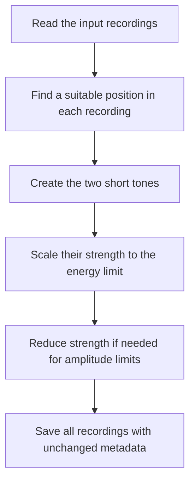

| Recording | What the sound contains | Model prediction |
| --- | --- | --- |
| Original | A bird singing | Birds |
| Modified | The same bird, with a small added signal | Rain |

| Material | How it helped |
| --- | --- |
| `recordings.csv` | Provided the correct labels, failure/reference status, paths, and file hashes. |
| `audio/` | Contained the recordings we could compare and modify. |
| `challenge-model.pt` and `challenge_model.py` | Let us inspect the classifier and run unlimited local predictions. |
| `audio_io.py` | Checked the audio shape, type, amplitude, and modification energy. |
| `baseline_solution.ipynb` | Showed how to load the data, implement a transformation, and save a submission. |
| `train-input.npz` and `train-output.npz` | Demonstrated the required file format. The supplied output contained unchanged audio. |

Of the 13 supplied failures:

- **12 were predicted as rain**, although their correct labels were birds, frogs, or insects.
- **One frog recording was predicted as birds.** It did not follow the recurring rain pattern and was treated as a separate, likely ordinary model error.

![[The Forest Went Quiet (Bolivia)/results/figures/recording_spectrograms.png|1000]]

| Removed range | Observation |
| --- | --- |
| 1,500–1,750 Hz | The recurring rain predictions largely disappeared. |
| 2,250–2,500 Hz | The recurring rain predictions also largely disappeared. |

| Property | Reconstructed value |
| --- | --- |
| First tone | 1,600 Hz |
| Second tone | 2,400 Hz |
| Duration of each tone | 0.08 seconds, or 80 milliseconds |
| Delay between their starts | 0.34 seconds, or 340 milliseconds |
| Fade at each tone's beginning and end | Approximately 0.008 seconds |

![[The Forest Went Quiet (Bolivia)/results/figures/trigger_frequency_spectrum.png|1000]]

![[The Forest Went Quiet (Bolivia)/results/figures/trigger_frequency_spectrogram.png|1000]]

![[The Forest Went Quiet (Bolivia)/results/figures/trigger_closeup.png|1000]]

1. Removing the relevant frequency ranges reduced the recurring failure.
2. Adding the reconstructed tone sequence reproduced the failure on other inputs.

