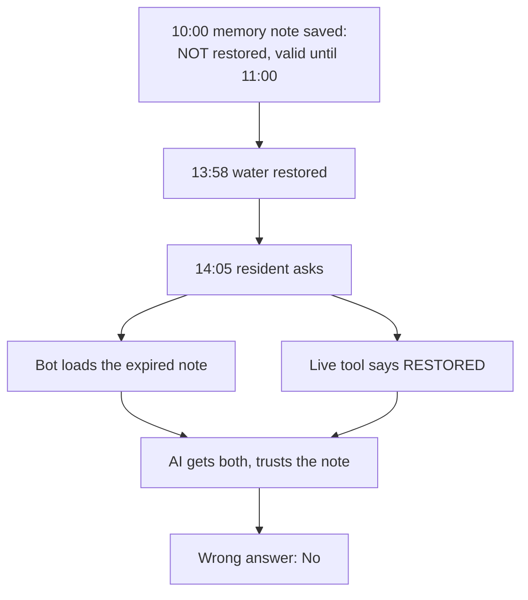

```
test-input.json
└── events            ← one long list of 20 steps
    ├── control-01        (steps 1–6)
    ├── incident-01       (steps 7–14)
    └── replay-no-memory  (steps 15–20)
```

| `event`                           | What it holds                                          |
| --------------------------------- | ------------------------------------------------------ |
| `runtime.config`                  | Settings (model, seed, memory on/off)                  |
| `assistant.prompt`                | The rules and the user's question                      |
| `memory.search` / `memory.result` | The bot looked in memory and what it found             |
| `tool.call` / `tool.result`       | The bot asked the live tool and what it answered       |
| `llm.request`                     | **Everything sent to the AI** (the "folder of papers") |
| `assistant.response`              | The bot's final answer                                 |

| Run | Memory | Live tool | Answer |
|---|---|---|---|
| `control-01` | none | RESTORED | "Yes" ✅ |
| `incident-01` | **SIGMOID_MEM_KILAMBA** | RESTORED | **"No"** ❌ |
| `replay-no-memory` | switched off | RESTORED | "Yes" ✅ |

Compare each run's answer with its live tool result. Only `incident-01` answers **"No"** while the tool says **RESTORED**.


`replay-no-memory` is the **same question** with the **same settings** and the **same tool result**, but with memory switched off (`memory_enabled: false`). It answers correctly.

The `llm.request` of `incident-01` contains one extra message that the good runs don't have:

```json
{ "role": "memory", "source_id": "SIGMOID_MEM_KILAMBA",
  "content": "Kilamba Sector 4: outage ongoing; water service has NOT been restored..." }
```

The AI received two papers that disagreed, memory saying "NOT restored" and the tool saying "RESTORED", and it believed the wrong one.

| Field | Value |
|---|---|
| `created_at` | 10:00 |
| `valid_until` | **11:00** |
| used at | **14:05** |

The note had **expired 3 hours earlier**, but it was still added to the context (`injected_into_context: true`).

---

## 5. Timeline of what went wrong

