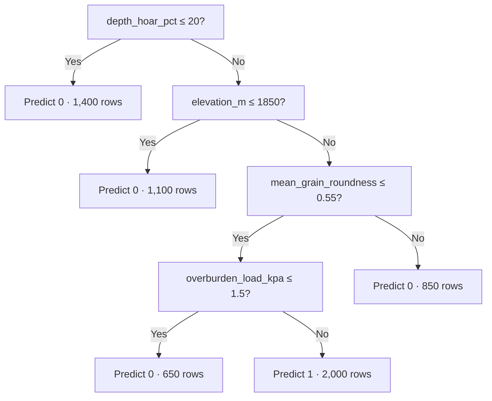

---
tags:
  - ctf
  - machine-learning
  - decision-tree
country: Switzerland
difficulty: easy
status: practice-verified
practice_flag: SIGMOID_DEMO
---


| File | What it contains | What we use it for |
| --- | --- | --- |
| `data/train-input.csv` | 6,000 snow observations with known outcomes | Develop the decoding method |
| `data/train-output.txt` | `SIGMOID_DEMO` | Check that our recovered word is correct |

The CSV is a table, like an Excel sheet. It has **28 columns**:

- **27 measurement columns**, such as snow depth, temperature, and elevation.
- **1 outcome column**, named `slab_released`.


| Tool | Role in this solution |
| --- | --- |
| Python 3.12 | Runs the instructions in our scripts; our local installation is 3.12.10 |
| pandas 2.3.3 | Reads the CSV as a table and selects columns |
| scikit-learn 1.7.2 | Provides the algorithm that trains the decision tree and exposes its structure |
| NumPy 2.2.6 | Provides numerical arrays and operations used by the libraries |
| pathlib | Python's built-in tool for file paths and writing the output file |

**scikit-learn is the library. `DecisionTreeClassifier` is the tool we select from it. The fitted tree is the model created from our data.**


```text
Is slope angle ≤ 30°?
├── Yes → predict 0
└── No → Is snow depth ≤ 150 cm?
         ├── Yes → predict 0
         └── No → predict 1
```

- A **node** is a point in the tree.
- An **internal node** contains a question.
- A **branch** connects a question to the next question or answer.
- A **leaf** is a final prediction.
- The **root** is the first node at the top.


The classifier's default split criterion is **Gini impurity**. For a group with labels `0` and `1`:

$$
G = 1 - p_0^2 - p_1^2
$$

Here, $p_0$ is the fraction of zeros and $p_1$ is the fraction of ones in the group.

For `[0, 1, 1, 1]`, the fractions are $1/4$ and $3/4$:

```text
G = 1 - (1/4)² - (3/4)² = 0.375
```

| Group | Gini impurity | Meaning |
| --- | ---: | --- |
| `[0, 0, 0, 0]` | 0 | Pure: only one outcome |
| `[0, 1, 1, 1]` | 0.375 | Mixed, with a majority of ones |
| `[0, 0, 1, 1]` | 0.5 | Maximum mixing for two classes |
| `[1, 1, 1, 1]` | 0 | Pure: only one outcome |

$$
G_{split} = \frac{n_L}{n}G_L + \frac{n_R}{n}G_R
$$




| Order | Selected feature | Cutoff | First letter |
| ---: | --- | ---: | --- |
| 1 | `depth_hoar_pct` | 20 | D |
| 2 | `elevation_m` | 1850 | E |
| 3 | `mean_grain_roundness` | 0.55 | M |
| 4 | `overburden_load_kpa` | 1.5 | O |
