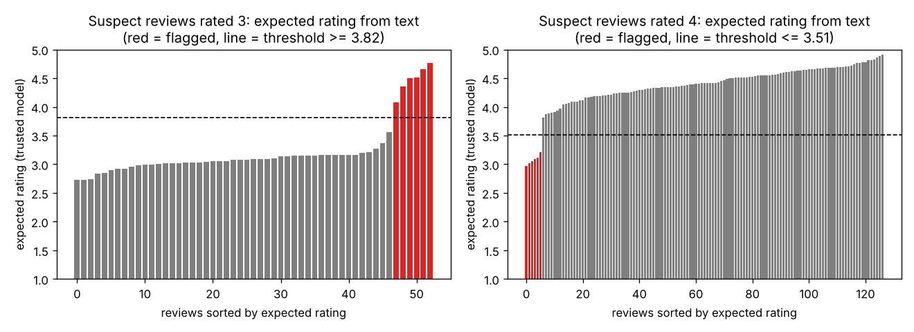

# Looks Good to Me! — Bogotá Sound Check

**Flag:** `SIGMOID_DATA_SANITIZATION`

Run: `pip install -r requirements.txt` then `python solve.py` (prints the full log, writes `FLAG.txt` and `results/`).

## How the altered records were found

The 1,000 trusted reviews are known to be clean, so they act as the reference for what "normal" looks like. Two kinds of tampering show up when the 1,200 suspect reviews are compared against them.

### 1. Text alterations: look-alike and invisible characters (12 records)

Every character used in the trusted text was collected. Twelve suspect reviews contain characters that **never** appear in any trusted review: Cyrillic letters that look identical to Latin ones (`а е о с`) and the zero-width space `U+200B`. They sit inside ordinary words near the start of the review ("windеr", "niсely", "swe​ar"), so the review still looks normal on screen.

Samples: 36, 119, 216, 273, 357, 367, 462, 478, 513, 685, 752, 1199.

### 2. Label alterations: the rating contradicts the text (12 records)

A TF-IDF (word 1–2-grams) + logistic-regression rating model was trained **only on the trusted reviews**, and gives each suspect review an *expected rating* from its text. For every star class we checked whether any reviews sit on the wrong side:

- Ratings 1, 2 and 5: none (no 1–2★ text reads positive, no 5★ text reads negative).
- **Rated 3, but the text reads positive:** six reviews score 4.07–4.77, then there is a jump down to 3.56. Samples 112, 198, 371, 432, 633, 1061. Sample 371 even says *"4 stars is my tops, anywhere"* but is rated 3.
- **Rated 4, but the text reads neutral or negative:** six reviews score 2.96–3.20, then there is a jump up to 3.81. Samples 347, 582, 622, 661, 1018, 1112 (e.g. "this one is just OK", "OK but nothing special").

Thresholds are set at the largest gap in each sorted list (see `results/rating_contradictions.png`). The pattern is a 6 + 6 swap between the 3★ and 4★ classes.

## Recovering the message

Following `archive_note`:

1. Sort the 24 altered `sample_index` values and join them with commas:
   `36,112,119,198,216,273,347,357,367,371,432,462,478,513,582,622,633,661,685,752,1018,1061,1112,1199`
2. SHA-256 of that text gives the 32-byte mask `987ebbc5…cf900f00`.
3. XOR every `archive_tag` (all 2,200, trusted and samples) with the mask and strip trailing zero bytes.

Exactly one seal becomes readable: `trusted_reference[613]` → **`SIGMOID_DATA_SANITIZATION`**.

**Controls:** the text-only set (12) opens no seal, the rating-only set (12) opens no seal, and removing any single record from the 24 also opens none. A wrong set gives a random mask, and the chance of a random mask producing a readable 25-character seal is negligible. So the readable flag also confirms that the set of altered records is complete and correct.

## Files

- `solve.py`: full pipeline (detection, decoding, controls, plot)
- `reviews.json`: task data
- `FLAG.txt`: the flag
- `results/report.txt`: printed log; `results/altered_records.csv`: the 24 records with evidence; `results/rating_contradictions.png`
