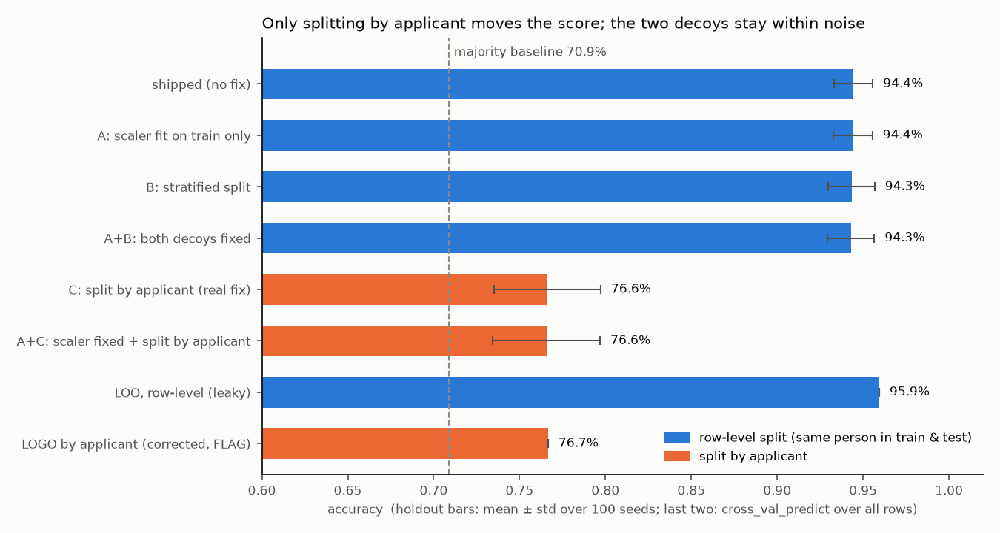

# task_estonia: "This Data Is Perfect!"

**Flag:** `SIGMOID_77`

Pre-launch audit of the e-Residency fraud screen (`project_pipeline.py`, reported accuracy **93.42%**).
The reported number comes from **applicants who are in the training and the test data at the same time**.
Once the evaluation is split by applicant, the shipped model (StandardScaler + 1-NN) scores **76.66%**,
only about 6 points above the 70.88% you'd get by labelling everyone "legitimate".

| File | What it is |
|---|---|
| `solve.py` | Full audit: reproduces 93.42%, tests each suspect in isolation (100 seeds), computes the flag |
| `corrected_pipeline.py` | The fixed pipeline (short and self-contained) |
| `project_pipeline.py`, `applications.csv`, `requirements.txt` | Provided materials (unchanged) |
| `results/report.txt` | Full printed output of `solve.py` |
| `results/metrics.json` | All numbers, machine-readable |
| `results/oof_predictions.csv` | One out-of-fold prediction per row, leaky LOO vs grouped LOGO |
| `results/decoys_vs_real_bug.png` | Chart below |
| `FLAG.txt` | The flag |

```
pip install -r requirements.txt matplotlib
python solve.py              # ~30 s, writes results/ and FLAG.txt
python corrected_pipeline.py # prints 0.7666 -> SIGMOID_77
```
Verified with Python 3.12.3, pandas 2.2.2, numpy 1.26.4, scikit-learn 1.5.1.

---

## 1. The three questionable choices

| # | Choice in `project_pipeline.py` | Why it looks wrong | Verdict |
|---|---|---|---|
| A | `StandardScaler().fit_transform(X)` runs on **all** rows **before** `train_test_split` | Test-set means/stds leak into preprocessing | **Decoy** |
| B | `train_test_split(...)` with **no `stratify=y`** although only 29.1% of rows are fraud | The test set's class mix could be lucky | **Decoy** |
| C | The split is done **per row** after the identity columns are dropped, but many applicants submitted **several applications** | The same person ends up in train and test | **Real bug** |

### Why C inflates the score

`date_of_birth + citizenship` identifies an applicant:

* 1,971 applications come from only **900 applicants**: 360 applied once, 195 twice, 159 three times, 186 four times.
  **81.7%** of rows belong to someone who applied more than once.
* A person's label never changes between their applications (100% consistent).
* Resubmissions are **near-copies**: within one applicant, the features vary by only **1%** of their overall spread.
* For **81.7%** of rows, the nearest neighbour in feature space is **the same applicant's other application**.

A 1-nearest-neighbour model with a row-level split does not learn what fraud looks like. It looks up
the same person's other application in the training set and copies the label. The comment
*"Identity fields ... are never used for modeling"* is correct, but those fields are still needed to
**build the evaluation split**. Dropping them before splitting hid the duplicates.

## 2. Evidence: each choice fixed in isolation

Holdout 80/20 evaluation, with every variant run on the **same 100 random seeds** (plus the shipped seed 1137).
Run-to-run noise of the shipped pipeline = **std 1.13 pp** across seeds.

| Variant | seed 1137 | mean of 100 seeds | std | change vs shipped |
|---|---:|---:|---:|---:|
| Shipped (no fix) | **0.9342** | 0.9443 | 0.0113 | n/a |
| **A** fixed: scaler fit on train only (Pipeline) | 0.9367 | 0.9440 | 0.0114 | −0.03 pp (0.0× noise) |
| **B** fixed: `stratify=y` | 0.9418 | 0.9433 | 0.0135 | −0.11 pp (0.1× noise) |
| **A + B** both fixed | 0.9392 | 0.9429 | 0.0136 | −0.14 pp (0.1× noise) |
| **C** fixed: split by applicant (`GroupShuffleSplit`) | 0.7995 | **0.7661** | 0.0311 | **−17.82 pp (15.8× noise)** |
| A + C | 0.8021 | 0.7656 | 0.0313 | −17.87 pp |

Paired differences on identical seeds: decoy A **−0.03 pp** (std 0.12), decoy B **−0.11 pp** (std 1.69).
Both decoys leave the score **unchanged within noise**. Only C moves it, by almost 16 standard deviations.

Same picture with leave-one-out:

| `cross_val_predict` scheme | accuracy |
|---|---:|
| `LeaveOneOut()`, scaler inside Pipeline (decoy A fixed, bug C **not** fixed) | 0.9594 |
| `LeaveOneOut()`, scaler fit on all rows | 0.9594 |
| `LeaveOneGroupOut()` by applicant, scaler fit on all rows (decoy A unfixed) | 0.7671 |
| **`LeaveOneGroupOut()` by applicant, scaler inside Pipeline (fully corrected)** | **0.7666** |

(Decoy B, stratification, does not apply to leave-one-out, because every fold holds out one row or one applicant.)



## 3. Corrected pipeline

Same model and features. The evaluation now holds out **one applicant at a time** (the grouped equivalent
of `LeaveOneOut()`), and the scaler is refit inside every fold:

```python
import pandas as pd
from sklearn.model_selection import LeaveOneGroupOut, cross_val_predict
from sklearn.neighbors import KNeighborsClassifier
from sklearn.pipeline import make_pipeline
from sklearn.preprocessing import StandardScaler

df = pd.read_csv("applications.csv")
X = df.drop(columns=["submission_id", "date_of_birth", "citizenship", "label"])
y = df["label"]
applicant = df["date_of_birth"] + "|" + df["citizenship"]   # grouping key, NOT a feature

model = make_pipeline(StandardScaler(), KNeighborsClassifier(n_neighbors=1))
pred = cross_val_predict(model, X, y, cv=LeaveOneGroupOut(), groups=applicant)  # 900 folds
acc = (pred == y).mean()   # 0.7666
```

Robustness check: grouping by `date_of_birth` alone (872 groups) gives the same 0.7666.

## 4. True performance

| | Accuracy |
|---|---:|
| Reported (row-level holdout, seed 1137) | 93.42% |
| Row-level leave-one-out (still leaky) | 95.94% |
| **Leave-one-applicant-out (corrected)** | **76.66%** (1,511 / 1,971 correct) |
| Majority-class baseline ("everyone legitimate") | 70.88% |

**True accuracy = 0.7666 → `SIGMOID_77`.**

The shipped screen is only about 6 points better than predicting "legitimate" for everyone. The 93.42% figure measured
how well the model recognises applicants it has already seen, not how well it flags new ones. It should not
be used to approve the nationwide rollout.
