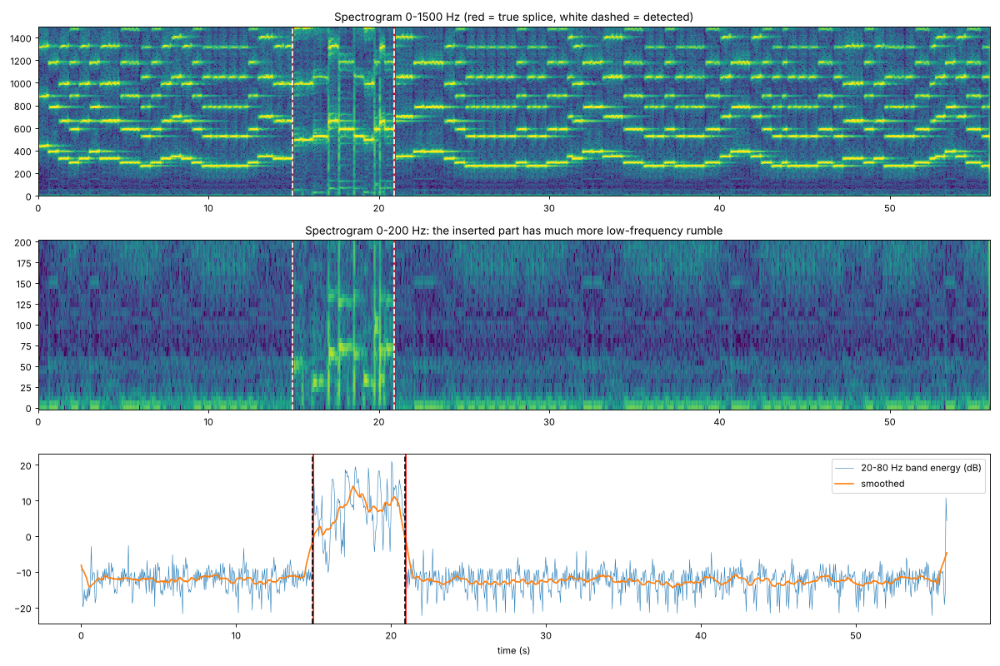
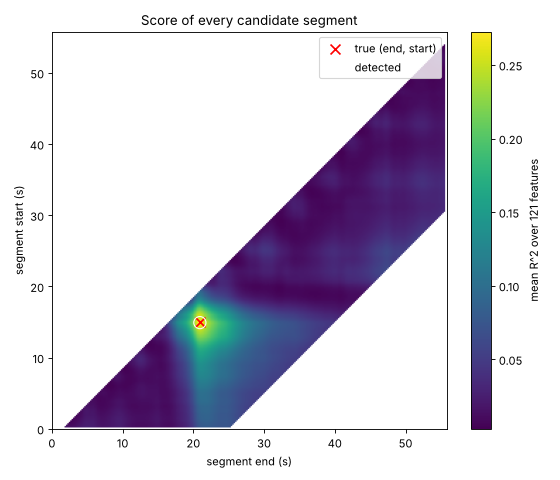

# The Azmari's Borrowed Melody (Ethiopia)

Find where a few seconds of a recording were replaced by audio from somewhere else.

**Deliverable:** `main.py`, run as `python main.py test-1-input.wav`. It writes `detection.csv` (`start_s,end_s`, one row, seconds).

## Files

| File | Purpose |
|---|---|
| `main.py` | The submitted detector (needs numpy + scipy only, runs in about 1 s) |
| `solve.py` | Reproduces the analysis: train check, plots, synthetic validation, `results/report.txt` |
| `check_local.py` | Runs `main.py` the way the harness does (clean folder, bare filename) and scores it on the training file |
| `train-input.wav`, `train-output.csv` | Provided training recording and its true splice boundaries |
| `results/` | Report and plots |

```
pip install -r requirements.txt
python check_local.py main.py
python solve.py
```

## Idea

The splice has no click and no volume jump, but audio recorded somewhere else carries a different fingerprint: a different background noise (here strong rumble below 100 Hz), a different spectral balance, and melody that does not repeat anywhere else in the take.

1. Cut the recording into frames every 50 ms and compute 121 features per frame:
   - energy in 40 log-spaced frequency bands (15 Hz to 11 kHz)
   - the background floor of each band (quietest 10 % of frames within 1 s), which ignores the notes and captures the room/microphone noise
   - spectral shape (band energies relative to the frame's loudness), which is unaffected by volume matching
   - repetition score: how closely the frame's spectrum matches its 5 best matches elsewhere in the take
2. Smooth every feature over 0.5 s.
3. Try **every** interval `[a, b)` between 1.5 and 25 s long. For each feature, compute how much of its variance the split "inside vs outside" explains (R² of a two-group model), then average over all features. The interval with the highest mean R² is the part that differs most from the rest of the take: the splice. Cumulative sums make this exhaustive search fast.

## Results

**Training recording:** truth 14.960–20.965 s, detected **14.925–20.925 s** (errors 0.035 s / 0.040 s, tolerance 1.5 s).





**Synthetic validation (234 recordings).** Foreign audio was spliced into genuine audio at random places, 2–12 s long, with a 50 ms crossfade and matched RMS, into the original take and two re-shuffled, pitch-shifted takes:

| Splice type | Pass |
|---|---|
| the real inserted audio, moved elsewhere | 18/18 |
| added low-frequency rumble (strong / weak / very weak) | 54/54 |
| different instrument (synthetic flute), with or without rumble | 36/36 |
| pitch-shifted phrase + rumble | 18/18 |
| added pink noise (5 % / 2 %), white hiss at −40 dB | 54/54 |
| different microphone bandwidth (low-pass 3.5 kHz) | 18/18 |
| reverb only | 11/18 |
| pitch-shifted phrase only (no channel change at all) | 13/18 |
| **Total** | **222/234 (94.9 %)** |

The misses only happen in the two artificial cases where the inserted audio carries no recording fingerprint at all. Every case with a channel difference, which is what the training splice shows, passes 100 %. Median boundary error on passes: 0.11 s.
