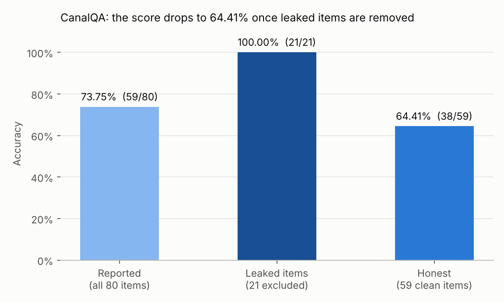

# Task Panama: The Canal Knows Too Much (CanalQA audit)

**Finding:** the 73.75% score is inflated by **benchmark contamination**. 21 of the 80 CanalQA
questions, with their answers, are in the corpus the assistant was fine-tuned on. Some are in
English, some were translated into Spanish, and the units and number formats were changed.
The assistant gets **all 21 of them right (100%)**. On the 59 clean questions it scores
**38/59 = 64.41%**, which is its honest accuracy.

| | items | correct | accuracy |
|---|---|---|---|
| Reported (whole benchmark) | 80 | 59 | 73.75% |
| Leaked items (excluded) | 21 | 21 | 100.00% |
| **Honest (clean items)** | **59** | **38** | **64.41%** |



The sealed certificate opens with this exclusion list and certifies 64.41%
(`results/seal_output.txt`). Flag: `SIGMOID_DECONTAMINATION`.

## How it was found

1. **The score reproduces:** 59 of the 80 `correct` flags are true, so 59/80 = 0.7375. The number is not
   miscounted. The problem is what it measures.
2. **Most of the corpus is routine operations logs:** shift reports, dredging, power, hydrology,
   visitor logs and safety drills (332 of 400 docs). They contain no facts that answer a CanalQA question.
3. **68 corpus docs are not logs. They are Q&A records** in three templates:
   - EN: `... the entry asks: '<question>' The logged response reads '<answer>' for <entity>.`
   - EN: `Question on record: '<question>' Answer on record: '<answer>'. Verified against the <entity> registry entry.`
   - ES: `Registro del canal ... ¿Cuál es <attribute> de <entidad>? Respuesta registrada: '<respuesta>'. Verificado en la entrada de <entidad> (<English name>).`
   They are written in CanalQA's own question style ("State the…", "Tell me the…",
   "According to the canal registry…"), so they are benchmark-style items that ended up in the
   training data.
4. **Each benchmark item is matched against each record** by `solve.py`, on three keys:
   - **entity**: the Spanish records give the English name in parentheses;
   - **attribute**: from the question text; Spanish words are translated with the lab's
     `glossary_es_en` (`manga` = beam, `desnivel` = lift height, `instalación` = facility,
     `año de finalización` = completion year), and "overall length" is treated as "length";
   - **answer**, normalised: decimal comma to point (`2,5`→`2.5`), units (`m`/`metros`→meters,
     `sq km`/`kilómetros cuadrados`→square kilometers), number words (`seis`→6,
     `nineteen ninety-nine`→1999) and glossary translation (`compuertas rodantes`→rolling gates,
     `división de dragado`→dredging division).

## Exclusion rule

An item is excluded when the corpus holds **the same entity, the same attribute and the same
fact** as the item. The model was trained on that question→answer pair, so a correct answer
shows memorisation, not ability.

**Excluded, exact leaks (19):** CQA-001, 002, 008, 012, 013, 018, 019, 022, 034, 035, 040, 051,
057, 058, 060, 061, 070, 074, 075. Eleven of them are disguised: 7 are in Spanish
(012, 019, 022, 034, 057, 060, 070) and 4 have abbreviated units (001, 002, 008, 035), e.g.
CQA-012 `rolling gates` ⇐ LOG-0056 `compuertas rodantes`, CQA-019 `6 cranes` ⇐ LOG-0209
`seis cranes`, CQA-022 `2.5 kilometers` ⇐ LOG-0120 `2,5 kilómetros`, CQA-060 `1912` ⇐ LOG-0227
`¿Cuál es el año de finalización de Represa de Gatún?`.

**Excluded, borderline paraphrased answers (2):**
- CQA-026 *State the location of Cristóbal* (gold `Atlantic terminal`) ⇐ LOG-0396 *Report the
  location of Cristóbal* → `Atlantic terminus`
- CQA-038 *Tell me the district of La Boca* (gold `Balboa township`) ⇐ LOG-0285 *Report the
  district of La Boca* → `Balboa district`

  The question is the same and the entity is the same. The answer states the same fact in other
  words (terminus ≈ terminal; the Balboa district/township). The model saw the answer to this
  exact question in training, so its correct answer cannot be credited to it. Both items are
  excluded.

**Kept: decoys that look like leaks but are not (the record cannot answer the item):**
- *Same entity, different attribute*, e.g. CQA-003 Coiba prison-closure year vs LOG-0117 Coiba
  **area**; CQA-032/055 Centennial Bridge span/tower vs LOG-0092 **completion year**; CQA-048
  Madden Dam power vs LOG-0186 completion year; CQA-024 La Boca **tug base count** vs LOG-0285
  district; CQA-079 Panamax **draft** vs LOG-0215/0352/0389 deadweight/beam/length.
- *Same attribute, different entity*, e.g. CQA-005 **Miraflores** lift height vs LOG-0354 Gatun /
  LOG-0370 Pedro Miguel; CQA-041 Neopanamax max length vs LOG-0389 **Panamax** length; CQA-049
  Miraflores chamber count vs LOG-0100 Pedro Miguel; CQA-047 Colón population vs LOG-0321
  Panama City; CQA-006 Alajuela vs LOG-0299 Bayano Lake.
- The other 48 Q&A records are about canal facts that CanalQA does not ask.

## Honest accuracy

Remaining items: 80 − 21 = 59. Correct among them: 59 − 21 = 38.
**Honest accuracy = 38/59 = 0.6441 (64.41%)**, about 9.3 points below the reported number.

Extra warning sign: all 21 wrong answers are gold answers to *other* CanalQA items, often of the
wrong type (e.g. "construction year of San Lorenzo Fort" → `427 meters`). The assistant gives
back answer strings it has stored instead of reasoning about the question. Even the 64.41% should
be read with that in mind.

## Files / how to run

```
python solve.py                 # finds leaks, writes report.json + results/
python open_seal.py report.json # opens the certificate -> flag
python make_chart.py            # optional, needs matplotlib
```
Standard library only (Python 3.10–3.12), except the optional chart.
`results/audit_report.txt` lists every leak, borderline item and decoy. `results/items.csv`
gives the status of every item.
