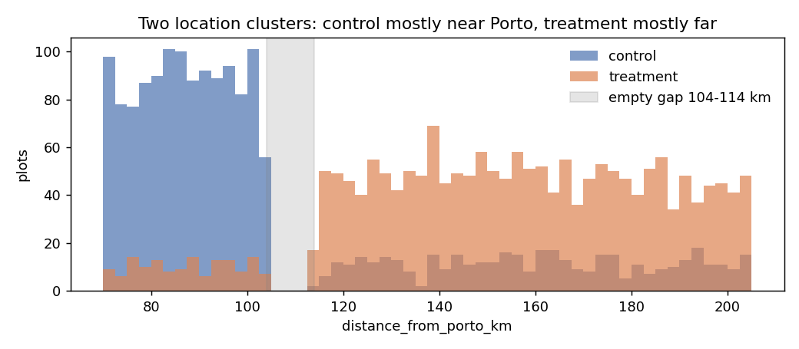
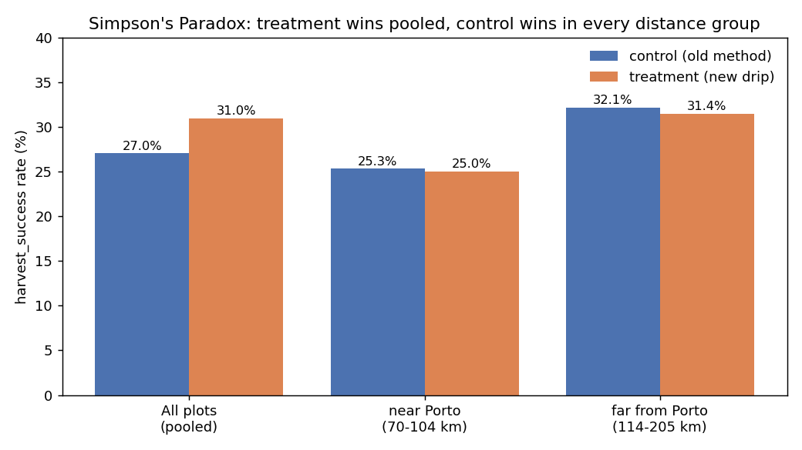

# Task Portugal: The Douro Paradox (Simpson's Paradox)

**Flag:** `SIGMOID_DISTANCE_FROM_PORTO_KM`

**Identified column:** `distance_from_porto_km`

Reproduce everything with `python solve.py` (pandas, numpy, matplotlib). The full printed output is in [`results/report.txt`](results/report.txt).

## 1. Overall: treatment ahead

| arm | plots | harvest_success rate |
|---|---:|---:|
| control (old method) | 1,653 | **27.04 %** |
| treatment (new drip irrigation) | 1,890 | **30.95 %** |

Pooled over all 3,543 plots, the new method is ahead by **+3.91 percentage points**.

## 2. The split: `distance_from_porto_km` in its two natural groups

The distances form two separate clusters. Neighbouring values are normally about 0.1 km apart, but **no plot lies between 104.0 km and 114.0 km**. That empty 10 km gap is the natural place to split:

- **near Porto:** 70.0 to 104.0 km
- **far from Porto:** 114.0 to 204.9 km

### Success rates within every group: control ahead in each

| group | control | treatment | winner |
|---|---:|---:|---|
| near Porto (70–104 km) | **25.30 %** (n = 1,233) | 25.00 % (n = 144) | **control** |
| far from Porto (114–205 km) | **32.14 %** (n = 420) | 31.44 % (n = 1,746) | **control** |
| *all plots, pooled* | 27.04 % (n = 1,653) | **30.95 %** (n = 1,890) | treatment |

Weighting both groups by their size (a location-adjusted comparison) gives control 29.48 % vs treatment 28.94 %, so control is still ahead.

## 3. Why pooling produces the reversal

The new method was trialled mostly far from Porto (92.4 % of treatment plots, against 25.4 % of control plots), where vineyards succeed more often anyway (31.6 % vs 25.3 % near Porto). Pooling therefore credits the location advantage to the treatment, even though treatment does worse than control inside both groups.

| | near Porto | far from Porto |
|---|---:|---:|
| share of control plots | 74.6 % | 25.4 % |
| share of treatment plots | 7.6 % | 92.4 % |
| baseline success rate (both arms) | 25.3 % | 31.6 % |

## 4. Why the other columns are not the answer

`solve.py` screens every column ([`results/column_screen.csv`](results/column_screen.csv)):

- **Categorical columns** (trellis_system, vineyard_age_group, cooperative, grape_variety, organic_certified, harvest_month, slope_aspect), split by their own levels: none gives a full reversal. The closest is cooperative, where control wins in only 3 of 12 cooperatives, and slope_aspect, where control wins in 1 of 4.
- **Numeric columns**, split at their natural gaps: soil_depth_cm also has a clear gap (70 → 110 cm), but treatment still wins in both groups, so it is a decoy. The other gaps (sun_hours_july, vine_density_per_ha, annual_rainfall_mm, elevation_m, soil_ph) only isolate a few outlier plots.
- **Exhaustive threshold scan**: for each numeric column we tried 181 cut points, keeping only cuts with at least 30 plots per arm on each side. Only `distance_from_porto_km` produces a full reversal, and only with cuts in its natural gap.

## Files

| file | content |
|---|---|
| `solve.py` | full analysis; regenerates everything below |
| `douro_vineyard_data.csv` | provided dataset (3,543 plots) |
| `results/report.txt` | printed report |
| `results/column_screen.csv` | reversal check for every candidate column |
| `results/reversal_plot.png` | pooled vs within-group success rates |
| `results/distance_histogram.png` | the two distance clusters and the empty gap |
| `FLAG.txt` | the flag |
