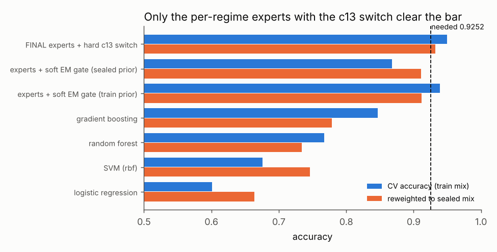

# task_romania: Shaken, Still Standing

**Flag:** `SIGMOID_CONVOLUTION` (printed by the official `evaluation_script.py` on our `predictions.csv`)

Binary classification: decide for each of the 5,000 sealed records whether it is a deep Vrancea earthquake.
The evaluator is a Reed–Solomon decoder. It only releases the flag if at least (n + k) / 2 = 4,626 of the
5,000 predictions are right, i.e. **accuracy ≥ 92.52 %**. It prints nothing else.

## Run

```
pip install -r requirements.txt
python solve.py                      # ~2-3 min; prints the report, writes predictions.csv, FLAG.txt, results/
python evaluation_script.py predictions.csv
```

## Files

| File | What |
|---|---|
| `solve.py` | the whole solution: data analysis, all models, nested validation, final predictions, evaluator call, plots |
| `predictions.csv` | final predictions (`record_id,vrancea`, 5,000 rows) |
| `FLAG.txt` | the flag |
| `results/report.txt` | full printed output of `solve.py` |
| `results/model_comparison.csv` | every model and its score |
| `results/family_by_network.csv` | which model family fits which regime |
| `results/*.png` | proof plots |
| `dataset/`, `evaluation_script.py`, `baseline_solution.py` | provided task material |

## How we got there

### 1. The usual single models are not enough
5-fold CV on train, all 48 channels: logistic regression 0.601, SVM 0.676, random forest 0.767,
gradient boosting 0.847. The best one (gradient boosting) gets **no flag**.

### 2. The data hides three regimes, each with its own rule
* **Sensor gain (regime A).** 36 of the 48 channels have excess kurtosis ≈ 1.1 (a scale mixture), and 12 are
  plain Gaussian. In 3,900 records the 36 "heavy" channels are recorded at exactly **0.25×** amplitude.
  The RMS of those channels separates the two gains with a clean gap (0.52 vs 0.68), see `01_gain_split.png`.
  Regime A is 25 % of train but **40 % of sealed**.
* **Regime A rule:** the label depends only on the 12 gain-free channels and is **quadratic** (an ellipsoid).
  Linear logistic regression scores 0.58 there; logistic regression on degree-2 polynomial features scores 0.93.
* **High-gain records:** gradient boosting found an interaction of c35/c43/c38 plus a linear signal.
  Analysis of the errors showed that **c13 is a hard switch** (`04_c13_switch.png`):
  * **c13 ≤ −0.589 (regime B):** label = 3-way **parity (XOR)** of `c35 > −0.226`, `c43 > −0.610`,
    `c38 > 0.727`. Parity scores 0.97 here; any linear model sits at 0.58.
  * **c13 > −0.589 (regime C):** label is **linear** in the channels. Logistic regression scores 0.94 here;
    parity sits at chance.
* **Covariate shift:** sealed is heavily enriched above the switch (80 % of its high-gain records vs. 34 % in
  train, `02_c13_shift.png`). Plain CV on train therefore over-weights the parity regime and
  over-estimates tree models on sealed.

### 3. Models per regime (5-fold CV inside each regime)

| regime | n (train) | logistic | logistic + degree-2 poly | SVM rbf | gradient boosting |
|---|---|---|---|---|---|
| A (low gain, 12 gain-free channels) | 1,900 | 0.583 | **0.928** | 0.915 | 0.833 |
| B (c13 low) | 2,965 | 0.583 | 0.631 | 0.637 | **0.979** (≈ parity) |
| C (c13 high) | 1,246 | **0.939** | 0.728 | 0.922 | 0.823 |

Rows B and C use the records the EM step assigned to each regime with confidence > 0.9.
Each regime is solved by a different model family, so no single model can do all three.

### 4. How we combined them
A routing ensemble (a hand-built tree with an expert in each leaf):

```
if RMS(36 heavy channels) < 0.6:      logistic regression on degree-2 features of the 12 gain-free channels
elif c13 <= -0.589:                   parity of (c35 > -0.226, c43 > -0.610, c38 > 0.727)
else:                                 logistic regression on all 48 channels
```

The c13 cut is learned from data: each expert is fitted far from the boundary, its out-of-fold correctness
is computed for every record, and the cut that maximises accuracy is chosen. Then both experts are refitted
on their own side. In nested CV the cut was stable at −0.587 to −0.594 across folds.

**Intermediate attempt:** a mixture of experts with a soft Gaussian gate on c13, trained by supervised EM.
It reached 0.939 CV on train, but only 0.912 reweighted to the sealed mix, and gave **no flag**,
because soft gating misroutes records near the boundary. Switching to the hard cut fixed that.

### 5. Results (nested 5-fold CV, whole pipeline refitted inside every fold)

| model | CV acc. (train mix) | CV acc. reweighted to sealed mix | evaluator |
|---|---|---|---|
| logistic regression | 0.601 | 0.664 | – |
| SVM (rbf) | 0.676 | 0.746 | – |
| random forest | 0.767 | 0.734 | – |
| gradient boosting | 0.847 | 0.779 | no flag |
| experts + soft EM gate | 0.939 | 0.912 | no flag |
| **experts + hard c13 switch (final)** | **0.950** | **0.933** | **SIGMOID_CONVOLUTION** |

Required: 0.9252. The expected sealed accuracy of the final model is about 0.933, roughly 337 errors
against the 374 the decoder tolerates. The remaining ~6–7 % error is label noise: the mistakes of each
expert look like label noise; for regime A, for example, a gradient-boosting model cannot predict them from the 48 channels (AUC ≈ 0.54).


