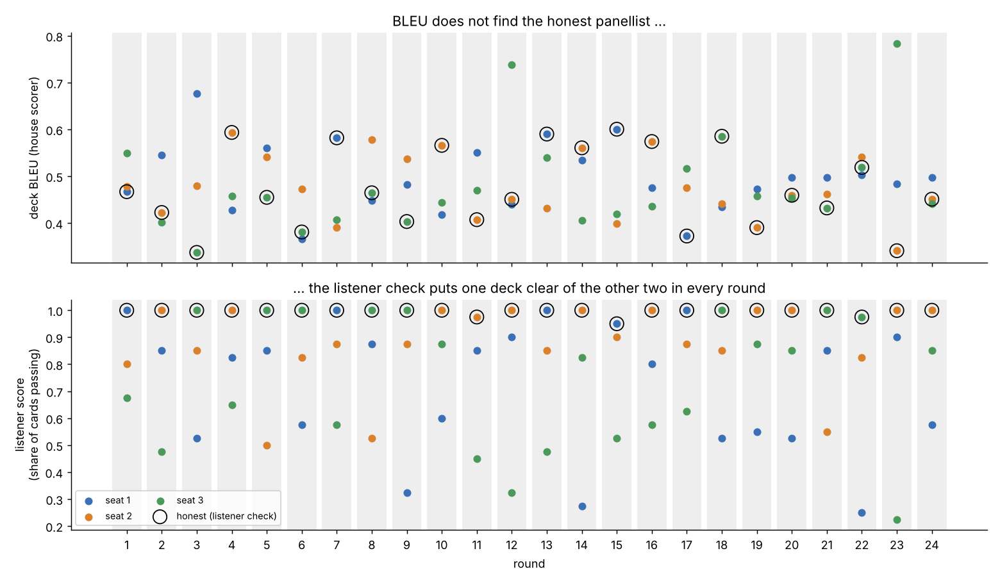
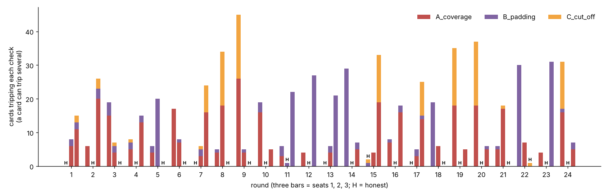

# Call My BLEUff: the listener check

**Flag:** `SIGMOID_FRINDLOW`

24 rounds, 3 panellists, 40 venue cards each. In every round one panellist is honest and two write
descriptions that please BLEU (the house scorer, `bleu.py`) instead of a listener. BLEU picks the
honest panellist in only 8 of 24 rounds (it spells `SIGMOID_SKELDRAP`); in 9 rounds the honest deck has
the *lowest* BLEU of the three.

```
python solve.py        # metric, evidence, figures, FLAG.txt   (pandas + matplotlib, ~30 s)
python verify_e2e.py   # optional independent cross-check, downloads the public E2E dataset
```

## 1. How the bluffers game BLEU

`bleu.py` is corpus-level BLEU-4: n-gram precision against 5 references, clipped per reference, no
smoothing, and one brevity penalty for the whole deck. Reading it gives three blind spots, and each
kind of bluff exploits one of them:

| BLEU blind spot | Bluff | What it looks like | Effect on the BLEU ingredients (`results/bluff_mechanisms.csv`) |
|---|---|---|---|
| **No recall.** Only output n-grams are checked; missing content costs nothing. | **Cut short:** truncate a description, drop facts, even the venue's name | "The Vaults is a pub near Café Adriatic." / "... It has a customer rating of 3 out." | 293 cards, ~31% shorter than the closest reference, only 50% of the venue's facts, but **4-gram precision 0.505** vs 0.257 for honest cards |
| **Brevity penalty is computed once per deck.** Long cards pay for short ones. | **Padded:** glue on extra reference-like sentences, restate a fact, stutter | "It is not family-friendly and has a low customer rating. The Cricketers is a pub near Ranch. The Cricketers is a one star pub near the Ranch." | 241 cards, ~19% longer than the closest reference, 4-gram precision 0.465. Bluffing decks keep a median brevity penalty of 0.991, practically none |
| **Matching is local.** An n-gram counts wherever it appears; grammar and order are never checked. | **Word salad:** fragments of the references glued together | "Zizzi is an with Indian food, has a pub with is highly rated high customer Rating." | n-grams like *highly rated*, *high customer Rating* still match; the salad loses the venue's facts (fact recall 0.57) |

Some bluffers do this on most cards (up to 31 of 40), some on only a handful (4 to 8 flagged cards), and they
use different tricks, which is why BLEU alone ranks them all over the place.

## 2. The metric: listener check

For every card, ask what a listener would notice. A card **passes** if it trips none of three checks:

* **A. Coverage:** the venue must be named, and the description must state at least 70% of the facts
  that at least 3 of the 5 references agree on (eat type, food, price, rating, area, family-friendly,
  nearby landmark). Facts are read with a small lexicon (e.g. *cheap / less than £20 / inexpensive*
  all mean price = cheap). Catches cut-short cards and word salad.
* **B. Padding:** a fact stated in two different sentences, an opening "It/They ..." before the venue
  has been named, or a repeated word or phrase ("more than more than £30").
* **C. Cut off:** the text ends on a dangling word (*of, out, the, with, near ...*) or is a reference
  with its tail chopped off.

**Listener score of a deck = share of its 40 cards that pass.** The honest panellist is the deck with
the highest score.

Calibration on the guide's own references (each tested against the other four of its card): B trips on
1.2% and C on 0.2% of references, and the venue goes unnamed in 0.02%. A trips on 14.6% because the
crowd-sourced references often leave facts out. The honest panellists are stricter than that: none of
their 960 cards fails coverage.

## 3. Results

| round | listener score s1 / s2 / s3 | flagged cards s1 / s2 / s3 | BLEU s1 / s2 / s3 | honest | digit |
|---|---|---|---|---|---|
| 1 | **1.000** / 0.800 / 0.675 | 0 / 8 / 13 | 0.467 / 0.478 / 0.549 | 1 | 0 |
| 2 | 0.850 / **1.000** / 0.475 | 6 / 0 / 21 | 0.546 / 0.422 / 0.402 | 2 | 1 |
| 3 | 0.525 / 0.850 / **1.000** | 19 / 6 / 0 | 0.676 / 0.479 / 0.337 | 3 | 2 |
| 4 | 0.825 / **1.000** / 0.650 | 7 / 0 / 14 | 0.428 / 0.593 / 0.457 | 2 | 1 |
| 5 | 0.850 / 0.500 / **1.000** | 6 / 20 / 0 | 0.560 / 0.541 / 0.455 | 3 | 2 |
| 6 | 0.575 / 0.825 / **1.000** | 17 / 7 / 0 | 0.366 / 0.472 / 0.381 | 3 | 2 |
| 7 | **1.000** / 0.875 / 0.575 | 0 / 5 / 17 | 0.582 / 0.391 / 0.407 | 1 | 0 |
| 8 | 0.875 / 0.525 / **1.000** | 5 / 19 / 0 | 0.448 / 0.578 / 0.465 | 3 | 2 |
| 9 | 0.325 / 0.875 / **1.000** | 27 / 5 / 0 | 0.482 / 0.537 / 0.403 | 3 | 2 |
| 10 | 0.600 / **1.000** / 0.875 | 16 / 0 / 5 | 0.418 / 0.566 / 0.444 | 2 | 1 |
| 11 | 0.850 / **0.975** / 0.450 | 6 / 1 / 22 | 0.551 / 0.407 / 0.470 | 2 | 1 |
| 12 | 0.900 / **1.000** / 0.325 | 4 / 0 / 27 | 0.439 / 0.451 / 0.739 | 2 | 1 |
| 13 | **1.000** / 0.850 / 0.475 | 0 / 6 / 21 | 0.590 / 0.432 / 0.540 | 1 | 0 |
| 14 | 0.275 / **1.000** / 0.825 | 29 / 0 / 7 | 0.535 / 0.561 / 0.405 | 2 | 1 |
| 15 | **0.950** / 0.900 / 0.525 | 2 / 4 / 19 | 0.600 / 0.399 / 0.419 | 1 | 0 |
| 16 | 0.800 / **1.000** / 0.575 | 8 / 0 / 17 | 0.476 / 0.574 / 0.436 | 2 | 1 |
| 17 | **1.000** / 0.875 / 0.625 | 0 / 5 / 15 | 0.372 / 0.475 / 0.517 | 1 | 0 |
| 18 | 0.525 / 0.850 / **1.000** | 19 / 6 / 0 | 0.434 / 0.442 / 0.585 | 3 | 2 |
| 19 | 0.550 / **1.000** / 0.875 | 18 / 0 / 5 | 0.472 / 0.390 / 0.458 | 2 | 1 |
| 20 | 0.525 / **1.000** / 0.850 | 19 / 0 / 6 | 0.497 / 0.459 / 0.453 | 2 | 1 |
| 21 | 0.850 / 0.550 / **1.000** | 6 / 18 / 0 | 0.497 / 0.462 / 0.432 | 3 | 2 |
| 22 | 0.250 / 0.825 / **0.975** | 30 / 7 / 1 | 0.503 / 0.541 / 0.519 | 3 | 2 |
| 23 | 0.900 / **1.000** / 0.225 | 4 / 0 / 31 | 0.484 / 0.341 / 0.784 | 2 | 1 |
| 24 | 0.575 / **1.000** / 0.850 | 17 / 0 / 6 | 0.497 / 0.451 / 0.441 | 2 | 1 |

* Honest decks: listener score 0.950 to 1.000 (0 to 2 flagged cards). Bluffing decks: 0.225 to 0.900 (4 to 31 flagged cards).
* The honest deck is the clear maximum in every round; the closest round is 15 (2 vs 4 flagged cards).
* **Robustness:** the same 24 seats come out for every combination of "facts agreed by 2 / 3 / 4
  references" and coverage threshold 0.6 / 0.7 / 0.8 (see `results/report.txt`).




## 4. Spelling the flag

Seat to digit: 1→0, 2→1, 3→2; three rounds per letter, value 9·d1 + 3·d2 + d3, 0→A.

| rounds | 1-3 | 4-6 | 7-9 | 10-12 | 13-15 | 16-18 | 19-21 | 22-24 |
|---|---|---|---|---|---|---|---|---|
| honest seats | 1 2 3 | 2 3 3 | 1 3 3 | 2 2 2 | 1 2 1 | 2 1 3 | 2 2 3 | 3 2 2 |
| digits | 0 1 2 | 1 2 2 | 0 2 2 | 1 1 1 | 0 1 0 | 1 0 2 | 1 1 2 | 2 1 1 |
| value | 5 | 17 | 8 | 13 | 3 | 11 | 14 | 22 |
| letter | F | R | I | N | D | L | O | W |

**`SIGMOID_FRINDLOW`**

## 5. Independent cross-check (not part of the metric)

The cards and texts come from the public **E2E NLG** dataset of crowd-sourced restaurant descriptions
(Novikova, Dušek & Rieser, 2017). All 4,800 references are verbatim E2E descriptions, so a panel text
that is not a verbatim E2E description was altered by its writer. `verify_e2e.py` downloads the dataset
and checks the result:

* In every round exactly one deck has **40/40** untouched texts, and it is the deck the listener check
  chose, in all 24 rounds.
* Card by card, the listener check flags 629 cards: **98.3%** of them really were altered, and it catches
  **92.4%** of the 669 altered cards. It flags 11 of 2,211 untouched texts by mistake.

## Files

| file | what it is |
|---|---|
| `solve.py` | the listener check, the BLEU decomposition, robustness grid, figures, `FLAG.txt` |
| `verify_e2e.py` | optional cross-check against the public E2E dataset |
| `bleu.py`, `baseline_solution.py`, `dataset/` | provided task materials (unchanged) |
| `results/report.txt` | full printed report |
| `results/deck_scores.csv` | listener score, flags per check and BLEU ingredients for all 72 decks |
| `results/card_checks.csv` | every check for every one of the 2,880 cards |
| `results/bluff_mechanisms.csv` | n-gram precision and length of each bluff type vs honest cards |
| `results/e2e_verification.txt` | output of `verify_e2e.py` |
| `FLAG.txt` | the flag |
